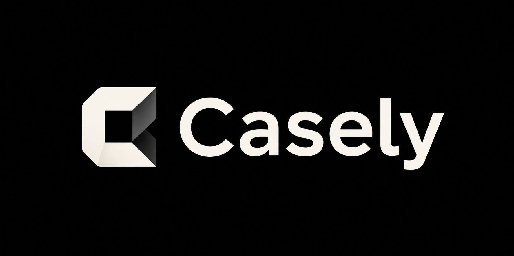

# 🚀 Casely — AI QA Test Case Generator

<div align="center">



**A free, open-source AI test case generator.** Turn requirements into TestRail-ready test cases in one conversation.

Attach a PDF, DOCX, or XLSX, or name a Jira issue, approve one test plan, and Casely returns:

TestRail-ready Excel or CSV files using your team’s columns.<br>
Runnable Postman collections for API specs.<br>
A list of gaps, contradictions, and untestable requirements.

**For you if** you are a manual QA engineer or QA lead who writes test cases from specs and imports them into TestRail, Qase, Zephyr or Xray.

<a href="#install"></a>

[](https://opensource.org/licenses/MIT)
[](https://github.com/JohnWayneeee/casely-qa-skill/releases)
[](https://github.com/JohnWayneeee/casely-qa-skill)
[](https://casely.digital/)

</div>

---

## Watch it work

https://github.com/user-attachments/assets/57f086c4-ec92-4a60-bc58-a00cc9757ee0

---

## The problem

You were hired to find bugs, and your week goes into writing test cases.

Requirements land as unstructured PDFs. Projects rename the columns, so you remap them each
sprint. One module takes two days to document, and then the TestRail import fails because the
headers don't match.

---

## How it works

Attach your files and say what you need:

> "Here are the requirements for the Payments module and two example test cases my team
> writes. Give me test cases for the refund flow."

Casely runs five phases in that same conversation:

| Phase | What happens |
|-------|--------------|
| **Intake** | Reads your PDF, DOCX or XLSX attachments. No parser, no OCR setup |
| **Style guide** | Copies the column structure and tone from your example file, and can save it so you attach it only once |
| **Test plan** | Proposes coverage, flags holes in the spec, then waits for your OK |
| **Generate** | Writes the cases using boundary values, decision tables and negative paths |
| **Export** | Builds one Excel file your TMS imports in a single pass, plus a Postman collection when the requirements describe an API |

You only get interrupted once, at the plan. Adjust the scope, drop a module, add negative
cases, or say "go".

---

## AI test case generation: a chat prompt vs Casely

| | Prompt in a chat | **Casely** |
|---|:-:|:-:|
| Reads PDF, DOCX, XLSX requirements | ✅ | ✅ |
| Uses your team's columns, order and ID scheme | ➖ if you describe them each time | ✅ copied once, saved for next time |
| Flags gaps and contradictions in the spec before writing | ➖ if you ask | ✅ in the plan |
| Waits for your approval of the coverage plan | ❌ | ✅ |
| Boundary values, decision tables, state transitions | ➖ varies | ✅ part of the plan |
| One Excel file TestRail imports in one pass | ❌ you format it | ✅ |
| Runnable Postman collection for API specs | ❌ | ✅ |
| Reads a Jira issue or Confluence page | ➖ you copy-paste it | ✅ Atlassian connector |
| Arabic, Korean and other non-Latin text survive the export | ➖ unchecked | ✅ round-trip tested |
| Walks the cases in a browser and reports pass/fail | ❌ | ✅ `/casely:run` in Claude Code |
| Price | your AI plan | your AI plan, Casely itself is free (MIT) |

## Tested against a benchmark

The repo ships a fintech wallet spec with five planted defects (a vague "processed quickly", a limit that
contradicts a worked example, an undefined "verified status" and more), boundary rules, a state machine and a
five-condition decision table, plus a 100-point rubric. The first full run scored **85/100**: 33 cases, all nine
team columns in order, one workbook with no rejected case. The misses were two of the five planted gaps; the rules
that catch them are now part of the skill. Details and the rubric: [`benchmark/README.md`](benchmark/README.md).

The export has its own test: `tests/test_export_roundtrip.py` writes Arabic and Korean cases with commas, quotes,
an escaped pipe and line breaks to XLSX and CSV, reads both back and compares every cell, the row count and the
column count. Run it with `python -m unittest discover tests`.

---

## Jira, Confluence, and a browser run

**Requirements from Jira or Confluence.** The plugin ships Atlassian's official remote MCP server
(`https://mcp.atlassian.com/v2/mcp`). Say "write test cases for PAY-142" or paste a Confluence link; the first time,
Atlassian's own sign-in page opens and you approve access. No API token goes into a file or the chat. Casely reads
the issue, its acceptance criteria and linked issues, and treats them like an attached spec. Name an epic or a sprint
and Casely lists its stories and asks which to cover. The issue key can go into a requirement column, so you can filter
the imported cases by story.

**Read only.** Casely never creates, edits or comments on anything in Jira or Confluence. A rule in a prompt is not a
lock, so grant read access only: an Atlassian admin can limit the server to read and search, and in Claude Code a
`permissions.deny` block removes the write tools. Copy the block from
[`references/connectors.md`](skills/casely/references/connectors.md).

**Attach your example once.** After the first run Casely offers to save your team's style as `casely-style.md`
(`.casely/style.md` in Claude Code): headers, order, ID scheme and the last ID used, with real data replaced by
placeholders. Next time it reads the file instead of asking for the example. On claude.ai, add the file to your
Project knowledge.

**Run the cases in a browser.** In Claude Code, after an export:

```
/casely:run https://staging.example.com
```

Casely walks each UI case through the Playwright MCP server, records pass, fail or blocked, saves a screenshot for
every failure and writes `run/run_report.md`. Connect Playwright once:
`claude mcp add playwright -- npx @playwright/mcp@latest`. API cases stay with Newman.

**CSV for trackers that want it.** Ask for CSV and the export adds `all_test_cases.csv`, UTF-8 with a BOM, so Excel
and TestRail keep non-Latin text intact.

---

## API requirements get a collection you can run

When the spec names endpoints — a path and a method, an OpenAPI file, `curl` examples, status
codes, an auth section — Casely says so in the plan and, once you approve, exports the API-level
cases as a Postman collection alongside the Excel file.

```
exports/
├── all_test_cases.xlsx                          # every case, your columns
├── casely_api_collection.postman_collection.json  # the API cases as requests
├── casely_api_environment.postman_environment.json # every variable, empty
└── casely_api_collection_README.md              # import, fill in, run, read results
```

- **Everything environment-specific is a variable.** `{{baseUrl}}`, `{{authToken}}`, entity ids.
  Fill them in once and the same file runs against dev, staging, or CI. The value a case is
  actually testing — `amount: 50001` — stays literal, because that is the point of the case.
- **No credentials in the file.** The build fails on anything shaped like a JWT or a secret key,
  so the collection is safe to commit next to the test cases.
- **Assertions come from the expected result.** Status code, response fields, error codes — one
  `pm.test` per thing the requirement promises, generated rather than hand-typed.
- **Requests are named after the cases.** A red assertion in Newman maps to a row in the Excel
  file without a lookup.
- **No endpoints in the spec, no collection.** Casely asks for the API docs instead of guessing
  a path that 404s on the first run.

Run it in the Collection Runner, or in CI:

```bash
newman run exports/casely_api_collection.postman_collection.json \
  -e exports/casely_api_environment.postman_environment.json \
  --env-var "authToken=<token from your CI secret store>"
```

---

## Install

**claude.ai, Cowork, and the Claude desktop app**

Install Casely from [Anthropic's plugin directory](https://claude.ai/customize/plugins/id/8bcda77b-fec6-46f2-b329-ebca18a801c1%40anthropic-plugin-directory)
in one click. Claude keeps it updated, and it syncs to Claude Code on the same account.

**Claude Code**

Paste this prompt and Claude runs the install:

```
Install the Casely plugin from https://github.com/JohnWayneeee/casely-qa-skill
```

Or install it as a plugin yourself, which also gets you updates with `claude plugin update`:

```bash
claude plugin marketplace add JohnWayneeee/casely-qa-skill
claude plugin install casely@casely
```

Or add just the skill to a project:

```bash
bunx skills add JohnWayneeee/casely-qa-skill
# or: npx skills@latest add JohnWayneeee/casely-qa-skill
```

**Codex**

Codex reads the same plugin manifest:

```bash
codex plugin marketplace add JohnWayneeee/casely-qa-skill
codex plugin add casely@casely
```

**Upload the zip by hand** (only if the plugin directory is not available to you)

1. Get the upload archive, already zipped with `casely/` at its root: download
   `casely-vX.Y.Z.zip` from the
   [latest release](https://github.com/JohnWayneeee/casely-qa-skill/releases/latest).

   Building it yourself works too — just not GitHub's own "Download ZIP" button, which wraps
   everything in `casely-qa-skill-main/skills/casely/` instead of putting `SKILL.md` at the
   archive root, which is what claude.ai requires:
   ```bash
   git clone https://github.com/JohnWayneeee/casely-qa-skill.git
   cd casely-qa-skill/skills && zip -r casely.zip casely
   ```
2. On claude.ai, open **Settings → Capabilities**, turn on **Code execution** if it isn't
   already, then go to **Skills → Create skill** and upload the zip.
3. The Claude desktop app uses the same account, so the skill is available there too —
   nothing to install separately.
4. Start a chat, attach your files, describe what you need.

Nothing to install locally. The export step uses `openpyxl`, which already ships inside
Claude's code execution environment. Custom skills are private to your account (Pro, Max,
Team, or Enterprise plan required) and won't sync to a Claude Code install — set that up
separately with the command above.

**Pick Opus.** The plan phase decides what gets tested at all: which boundaries matter,
which conditions combine, which requirement is too vague to test. Smaller models write
acceptable cases from a plan they were handed, and miss the holes in the spec.

---

## What you get

- **`exports/all_test_cases.xlsx`** with one row per case and your own column headers. Import
  it once instead of forty times. Ask for CSV and you also get `all_test_cases.csv`.
- **`results/*.md`**, one file per case, so you can review or version-control them separately.
- **A Postman collection, an environment file and run instructions** when the requirements
  describe an API — every base URL, token and id already pulled out into variables.
- **A list of holes in the spec**: contradictions, untestable wording ("should be fast"), and
  error paths the requirements never mention.

The export refuses to write a file it cannot read faithfully. A case that reaches TestRail
without its steps costs more than a failed export, so malformed input gets named and fixed
before delivery.

---

## FAQ

<details>
<summary>Do I need to run commands?</summary>

No. Attach the files, describe what you need, and answer when Casely asks which module to
cover. The one place it pauses is the test plan.

</details>

<details>
<summary>Can I use my team's own Excel columns?</summary>

That is the point. Attach an existing test case file and Casely copies the headers, their
order and the writing style. No config file. Say yes when it offers to save the style, and the
next conversation needs no example.

</details>

<details>
<summary>Does it work with Russian requirements?</summary>

Yes. Casely writes the cases in the language of your examples.

</details>

<details>
<summary>Which test management systems can import the output?</summary>

Any tool that reads Excel: TestRail, Qase, Zephyr, Xray. The columns match whatever your team
already uses.

</details>

<details>
<summary>Can it produce API tests I can actually run?</summary>

Yes, when the requirements name endpoints. Casely says in the plan how many cases are
API-level, and after your approval it exports them as a Postman collection with an environment
file and a README. Base URL, tokens and entity ids are variables you fill in once; nothing is
hardcoded, and no credential ever lands in the file. Run it in Postman or with Newman in CI.
If the spec only describes screens and flows, Casely asks for the API docs rather than
inventing endpoints.

</details>

<details>
<summary>Is there a free AI test case generator?</summary>

Casely is free and open-source under the MIT license. You pay only for the Claude or Codex plan you already use.

</details>

<details>
<summary>Can I import AI-generated test cases into TestRail?</summary>

Yes. Casely exports one `.xlsx` with your team's column headers, so the TestRail Excel/CSV import maps it in a
single pass. The same file works for Qase, Zephyr and Xray.

</details>

<details>
<summary>What about scanned PDFs?</summary>

Text-based PDFs, DOCX and XLSX work well. An image-only scan with no selectable text may not
extract cleanly, so export a text version when you can.

</details>

---

## Project structure

```
casely-qa-skill/
├── .claude-plugin/          # plugin + marketplace manifests (Claude Code, Codex)
├── .mcp.json                # Atlassian remote MCP (Jira, Confluence), OAuth sign-in
├── commands/run.md          # /casely:run, walks the cases in a browser via Playwright MCP
├── tests/                   # export round-trip test (Arabic, Korean, CSV, XLSX)
├── skills/casely/
│   ├── SKILL.md               # the skill definition and workflow
│   ├── scripts/
│   │   ├── export_to_xlsx.py            # Markdown → Excel (and CSV) exporter
│   │   └── build_postman_collection.py  # API cases → Postman collection
│   ├── references/            # test design, style, saved style, connectors, export, API
│   └── evals/                 # evaluation cases
├── benchmark/                # sample spec + team style file, and a scoring rubric
└── docs/hosted-web-version.md
```

---

## Hosted version for teams

This skill runs inside your AI assistant. If your team wants a browser UI, file uploads and a
review flow with no setup, join the early access list at
**[casely.digital](https://casely.digital/)**.

[More about the hosted version →](docs/hosted-web-version.md)

---

## Contributing

Read [CONTRIBUTING.md](CONTRIBUTING.md) before opening a pull request.

- 🐛 [Report a bug](https://github.com/JohnWayneeee/casely-qa-skill/issues/new?template=bug_report.md)
- 💡 [Request a feature](https://github.com/JohnWayneeee/casely-qa-skill/issues/new?template=feature_request.md)

---

## License

[MIT](LICENSE)

<div align="center">

*Made for QA engineers who find bugs. Casely writes the documents.*

</div>

---

## Support the project

Casely is free and MIT licensed. Changes are checked against the benchmark in this repo. Two ways to help:

- ⭐ **[Star the repo](https://github.com/JohnWayneeee/casely-qa-skill).** It takes a second and helps other QA engineers find it.
- ☕ **[Buy me a coffee](https://buymeacoffee.com/JohnWayne).** If Casely saved you a day of formatting test cases, a coffee pays for the next benchmark run and the next release.
